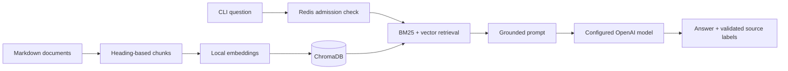

# RAG Documentation Assistant

Ask questions about Markdown documentation and receive answers with traceable source citations. This Python application combines structure-aware chunking, local embeddings, hybrid retrieval, a LangGraph pipeline, and OpenAI generation. Upstash Redis controls query admission across processes.

The project includes a character-splitting baseline so you can compare fragmented chunks against complete Markdown sections using the same documents.

## Features

- **Structure-aware ingestion:** Split Markdown at H2/H3 headings while preserving fenced code examples.
- **Local embeddings and storage:** Use `all-MiniLM-L6-v2` with a persistent ChromaDB index.
- **Hybrid retrieval:** Combine BM25 keyword search and vector similarity with Reciprocal Rank Fusion.
- **Cited answers:** Build prompts from retrieved documentation and validate returned source labels.
- **Shared rate limiting:** Use an atomic Redis Lua script before retrieval or model calls.
- **Repeatable checks:** Run configuration diagnostics, regression tests, and optional live-service verification.

## Architecture



LangGraph runs `retrieve → build_prompt → generate` and stops on stage errors. Redis denies excess requests before this graph starts.

## Quick start

**Requirements:** Python 3.14, an OpenAI API key with access to your selected model, an Upstash Redis REST endpoint with a write-capable token, and internet access for installation and the first embedding-model download. The documented environment was validated on Windows.

```powershell
git clone https://github.com/harshgavandit/rag-documentation-assistant.git
cd rag-documentation-assistant
python -m venv .venv
.\.venv\Scripts\python.exe -m pip install -r requirements.lock.txt
Copy-Item .env.example .env
```

Edit `.env` with your own credentials:

```dotenv
OPENAI_API_KEY=your_openai_api_key
OPENAI_MODEL=gpt-6-luna
UPSTASH_REDIS_REST_URL=https://your-database.upstash.io
UPSTASH_REDIS_REST_TOKEN=your_write_capable_token
```

Then ingest the bundled educational documentation and ask a question:

```powershell
.\.venv\Scripts\python.exe main.py ingest
.\.venv\Scripts\python.exe main.py check --live
.\.venv\Scripts\python.exe main.py query "How does FastMCP register a tool with the MCP server?"
```

Expected answer format:

> FastMCP registers a tool by decorating a Python function with `@mcp.tool()`. The function's type hints define the parameter schema, and its docstring provides the tool description. [Source: MCP_Documentation.md, Section: 7. Building the MCP Server with FastMCP]

This example reflects the observed live test; generated wording can vary. Add your own `.md` files to `docs/` and run ingestion again to index them.


## Setup on Windows

Use Python 3.14 (the verified runtime) and run these commands from this folder:

```powershell
python -m venv .venv
.\.venv\Scripts\python.exe -m pip install -r requirements.lock.txt
# Only copy this if you do not already have a configured .env:
Copy-Item .env.example .env
```

The existing `.env` must contain `OPENAI_API_KEY`, `OPENAI_MODEL`, `UPSTASH_REDIS_REST_URL` and `UPSTASH_REDIS_REST_TOKEN`. The Redis token needs write/EVAL permission. Environment variables take precedence over `.env`. Credentials are excluded from version control. The application reads `.env` and resolves default storage/document paths relative to the project root, even when invoked from another directory.

`requirements.txt` lists direct dependencies; `requirements.lock.txt` records the complete environment validated on Windows/Python 3.14. First ingestion downloads the `all-MiniLM-L6-v2` embedding model to `.cache/huggingface/hub`; subsequent runs reuse it. To prevent model-cache network checks after downloading, set `$env:HF_HUB_OFFLINE='1'`.

## Run

```powershell
# Local configuration, documents and collection readiness
.\.venv\Scripts\python.exe main.py check
# Also check real Redis authentication and OpenAI model access (no generation charge)
.\.venv\Scripts\python.exe main.py check --live
# Index the Markdown files in docs/
.\.venv\Scripts\python.exe main.py ingest
# Ask a grounded question
.\.venv\Scripts\python.exe main.py query "How does FastMCP register a tool with the MCP server?"
# Check the documented refusal behavior
.\.venv\Scripts\python.exe main.py query "What is the rate limit on the Stripe API?"
# Compare chunking without API calls or database writes
.\.venv\Scripts\python.exe main.py compare
# Compare, ingest semantic chunks, then ask one question
.\.venv\Scripts\python.exe main.py
```

The existing individual scripts also work: `demo/chunking_comparison.py`, `demo/ingest_structure_based.py`, `demo/ingest_char.py` and `demo/user_query.py`.

The character-splitting demonstration has its own collection, so it does not mix with the semantic index:

```powershell
.\.venv\Scripts\python.exe main.py ingest --strategy character
.\.venv\Scripts\python.exe main.py query --strategy character "How does FastMCP register a tool?"
```

No database deletion is necessary to switch demonstrations. Re-ingesting a document upserts stable IDs and removes obsolete trailing chunks for that document. Other documents remain intact. If a document is removed from `docs/`, its existing stored chunks are retained; explicitly manage that lifecycle when needed. Changing the embedding model requires a new `CHROMA_PATH` or `COLLECTION_NAME` followed by ingestion.

## Configuration and rate limiting

| Variable | Default | Purpose |
|---|---|---|
| `OPENAI_MODEL` | `gpt-6-luna` | Actual model used for generation |
| `OPENAI_MAX_COMPLETION_TOKENS` | `2048` | Maximum completion budget |
| `OPENAI_TIMEOUT_SECONDS` | `60` | Provider request timeout |
| `OPENAI_MAX_RETRIES` | `0` | Automatic provider retries; zero keeps admission aligned to attempts |
| `RATE_LIMIT_REQUESTS` | `20` | Shared queries admitted in one window |
| `RATE_LIMIT_WINDOW_SECONDS` | `60` | Window duration, starting at the first admitted query |
| `RATE_LIMIT_PREFIX` | `rag:rate-limit` | Application namespace; use a separate value for each deployment |
| `REDIS_TIMEOUT_SECONDS` | `10` | Redis REST timeout |
| `TOP_K` | `5` | Number of retrieved chunks sent to the model |
| `EMBED_MODEL` | `all-MiniLM-L6-v2` | Local embedding model |
| `DOCS_PATH` | `docs` | Source Markdown directory |
| `CHROMA_PATH` | `chroma_data` | Persistent local vector database |
| `COLLECTION_NAME` | `rag_docs` | Semantic collection name |

The Redis key also scopes by collection and generation model. One atomic Lua script checks and updates the counter and TTL. Rejected requests do not extend the window. All CLI processes using the same namespace share the quota; this is application admission control, not a per-user or token-based provider quota. Each admitted query consumes one slot even if a later stage fails. Redis failure blocks the query, with no in-memory bypass. A rejected query includes a retry delay and exits nonzero.

Generation honors the configured model and uses `max_completion_tokens`. Responses that are empty, truncated, uncited, or contain unknown source labels are rejected. Citation validation confirms source-label membership; it does not independently prove every claim. Prompt instructions request grounded answers and exact refusal for unsupported questions. Retrieved text is sent to OpenAI when running a query; place only documentation suitable for that provider in `docs/`.

## Verification

```powershell
.\.venv\Scripts\python.exe -m unittest discover -s tests -v
.\.venv\Scripts\python.exe -m pip check
# Real services, two small generation calls and expiring isolated Redis test keys
.\.venv\Scripts\python.exe -u verification/verify_live.py
```

`verification/live_report.json` is generated locally and stores observed live checks and generated answers without credentials. Runtime reports, vector databases, model caches, virtual environments, and `.env` files are excluded from the repository. The checked-in [verification record](verification/VERIFICATION.md) documents the measured baseline. The live verifier checks readiness, atomic admission under concurrency, quota shared with a second process, denial before the model path, expiry recovery, invalid-token rejection, a FastMCP answer with source citations, and exact out-of-scope refusal. Test keys expire automatically; the verifier does not flush Redis or reset ChromaDB.

## Modules

- `config/settings.py`: root-relative configuration and validation.
- `chunking/`: character baseline, Markdown heading chunker and comparison statistics.
- `vectorstore/`: cached local embedding model and persistent Chroma storage.
- `retrieval/`: semantic search plus BM25/vector Reciprocal Rank Fusion.
- `generation/`: grounded prompt construction and configured OpenAI generation.
- `pipeline/`: typed state, LangGraph nodes, Redis admission control and diagnostics.
- `demo/`: individual command-line demonstrations.
- `tests/`: regression checks for errors, boundaries, citation handling and ingestion.
- `verification/`: real-service verification and evidence.

This checkout provides a local CLI. It has no HTTP service, browser interface, authentication layer or deployment configuration. A hosted service would require those components plus trusted user identity if per-user limiting is needed. Replacing Chroma with another database requires implementing the collection operations used by storage and retrieval; it is not a drop-in one-file configuration switch.

`requirements.md`, `Project_Documentation.md` and `Project_Documentation.pdf` describe the original teaching specification. This README documents the runnable implementation and commands.

## Validation baseline

The project was verified locally on 14 October 2026 (India time). The [verification record](verification/VERIFICATION.md) describes the evidence and its limits.

| Check | Observed result |
|---|---|
| Behavioral regression tests | 14 passed |
| Semantic ingestion | 2 documents, 39 chunks; unchanged after re-ingestion |
| Configured model | Real generation succeeded with `gpt-6-luna` |
| Grounded question | Answer cited the expected FastMCP section |
| Unsupported Stripe question | Exact refusal, no citations |
| Concurrent Redis admission | With limit 3, exactly 3 of 10 admitted |
| Shared quota and expiry | Separate process denied; request admitted after expiry |
| Character baseline | 83 separate chunks; live CLI query succeeded |

These are dated local results, not a hosted service status or a capacity benchmark.

## Troubleshooting

| Symptom | Next step |
|---|---|
| Missing configuration | Fill the required variables in `.env`; check that shell variables are not overriding them. |
| Collection not found or zero chunks | Run `python main.py ingest` using the project virtual environment. |
| OpenAI authentication, access, or billing error | Check the key's project, model permissions, and available API quota. |
| Redis HTTP 401 | Use the correct REST token for the configured database. |
| Redis command rejected | Check that the token supports writes and `EVAL`. |
| Rate limit exceeded | Wait for the reported retry delay or adjust the configured application limit. |
| Embedding-model download fails | Restore network access; after downloading, use the local cache and optional offline setting. |
| Answer rejected for citations or truncation | Check the retrieved context and completion token budget; the application does not return an incomplete or invalidly cited answer. |

## Scope and limitations

- This application runs as a CLI. It does not provide a hosted HTTP API or web interface.
- Source-label validation checks that citations name retrieved sections; it does not independently verify every generated claim.
- The rate limit applies to application queries. It does not model provider token quotas or identify individual users.
- Heading-based chunking preserves section boundaries. The word threshold triggers H3 splitting and does not impose a hard size limit on sections without usable subheadings.
- Chunks for documents deleted from the source folder remain stored until explicitly managed.
- Retrieved documentation is transmitted to OpenAI during generation. Use documentation appropriate for your provider and deployment.
- `requirements.md` and the original project documentation are retained for reference; this README describes the current runnable application.
